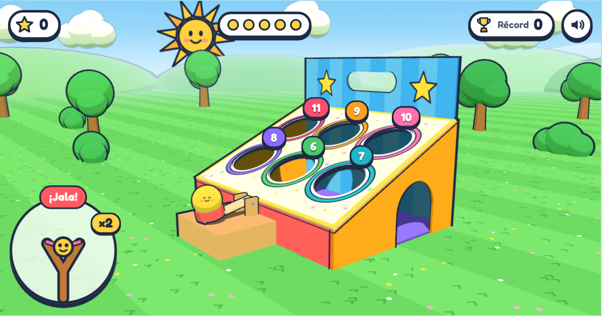

# Tablero de lanzamientos

Jueguito en 3D de la catapulta y la caja de blancos del proyecto (MDF de 3 mm, corte láser).

**Página:** https://miguelin777.github.io/ModeloDeProductoGanador/

- Jala la resortera y suelta: 5 tiros, estrellas y récord.
- Puntos por hoyo: arriba 11, 9 y 10; abajo 8, 6 y 7.
- Bolita chica de 3.5 cm (puntos ×2) o grande de 4 cm (puntos ×3); también se escoge el ángulo, la fuerza y la columna.
- Cuando cae en un hoyo, la bolita sale por un lado de la caja y regresa a la catapulta.
- Chequeo del cubo de 30 × 30 × 30 cm, lista de piezas y plano del tablero de 30 × 24.17 cm con los 6 hoyos de 6.5 cm.

Todo vive en `index.html` (Three.js desde CDN), así que no hay que instalar nada: se abre en el navegador y ya.
